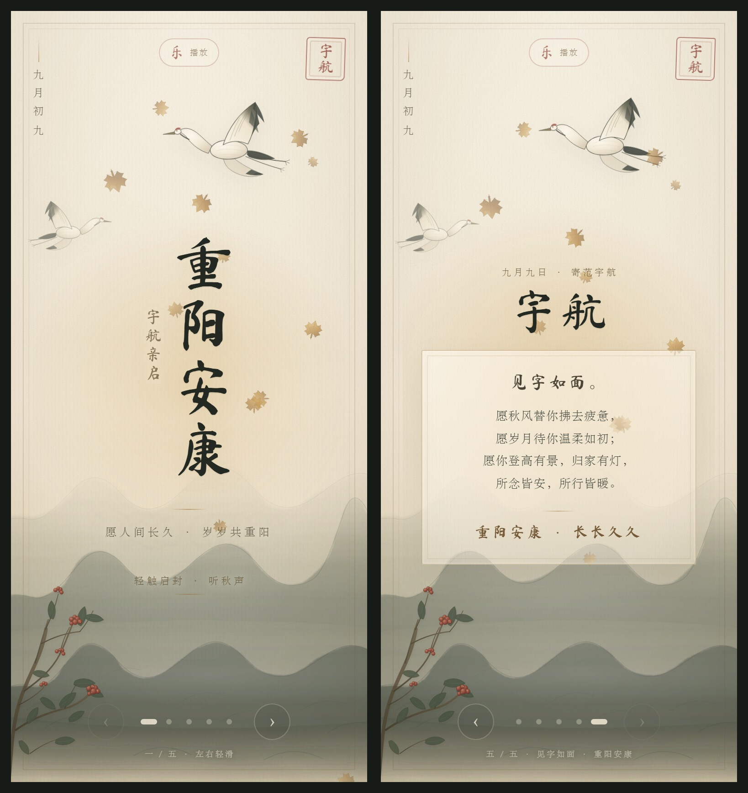

# 重阳安康 · 写给范宇航

五页互动国风水墨重阳祝福，纯 HTML + CSS + 原生 JavaScript，无构建步骤。

**在线访问：<https://ff-domo.github.io/chongyang-blessing/>**

已使用 GitHub Pages 从 `main` 分支根目录发布，并设置 `noindex`，不让搜索引擎收录这封私人祝福。



## 五个页面

1. **重阳安康** · 宇航亲启：愿人间长久，岁岁共重阳
2. **岁岁长安** · 九九重阳：愿君如菊，淡然且长久
3. **人间长久** · 登高望远：愿范宇航所念皆安，所行皆暖
4. **秋安祝福签** · 一叶秋光寄宇航：可反复点击“再求一签”
5. **写给宇航的信** · 九月九日寄范宇航：见字如面，重阳安康，长长久久

## 配乐

- 两首国风配乐：`水墨茶艺`、`花好月圆`
- 已统一音量并压到 128 kbps，适合手机加载
- 首尾相接循环播放
- 打开页面会先尝试自动播放；顶部按钮显示“乐 播放”或“乐 停止”
- 如果手机浏览器拦截了无交互播放，第一次点击 / 轻触页面任意位置（包括“轻触启封”或滑动翻页）即自动起乐，按钮变为“乐 停止”，点击即可停止
- 手机浏览器不允许完全无交互的自动播放，因此需要一次点击作为起乐手势
- 切到后台会自动停止

## 交互

- 手机上左右滑动翻页，桌面上可拖拽
- 底部左右箭头和圆点页签
- 键盘 `←` / `→` / `Home` / `End`
- 封面“轻触启封”
- 第四页可反复抽取随机祝福
- 支持系统“减少动态效果”设置

## 文件

```text
index.html   完整页面，字体与图形内嵌
music/
  shuimo-chayi.mp3    水墨茶艺（约 2 分钟）
  huahao-yueyuan.mp3  花好月圆（约 1 分钟）
preview.jpg  README 预览图
.nojekyll    让 GitHub Pages 直接按静态文件发布
README.md    本文件
```

页面排版、手绘山水、仙鹤、茱萸与飘落枫叶均在 `index.html` 内完成；只有配乐是独立音频文件，便于手机边下边播。

## 更新已发布的页面

- 在 GitHub 仓库网页中打开 `index.html`，点击铅笔图标编辑，提交后 GitHub Pages 会自动重新构建。
- 或克隆仓库，修改 `index.html` 后 `git push`，同样会自动更新。
- 替换配乐时，把新的 MP3 放进 `music/`，并同步修改 `index.html` 里的两处文件名即可。

## 重新部署

### 网页上传

1. 新建一个 **Public** 仓库，例如 `chongyang-blessing`。
2. 上传 `index.html`、`README.md`、`preview.jpg`、`.nojekyll` 以及整个 `music/` 文件夹。
3. 进入仓库 **Settings → Pages**。
4. **Build and deployment → Source** 选择 **Deploy from a branch**。
5. Branch 选 `main`，目录选 `/ (root)`，保存。
6. 等待 1–2 分钟即可访问。

### 命令行

```bash
cd chongyang-blessing
git init -b main
git add .
git commit -m "Add personalized Chongyang greeting"
git remote add origin https://github.com/<用户名>/chongyang-blessing.git
git push -u origin main
```

推送后在仓库 **Settings → Pages** 选择 `main` 分支的 `/ (root)` 并保存。

## 说明

- GitHub Pages 免费站点需要一个公开仓库；本页已设置 `noindex`，但仓库本身仍是公开的。
- 如果主要给国内移动网络访问，GitHub Pages 偶尔会较慢；可以再把整站（含 `music/`）部署到 Cloudflare Pages、Netlify 或 Vercel，页面无需改动。
- 书法字体为「马善政毛笔楷书 Ma Shan Zheng」，已按页面用字子集化内嵌，遵循 SIL Open Font License 1.1。
- 枫叶外轮廓取自 CC0 图形；远山、仙鹤、茱萸、云雾等均由 SVG/CSS/Canvas 代码绘制。
- 两首配乐由项目作者提供，仅用于这份私人祝福页面。
